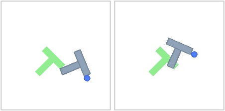
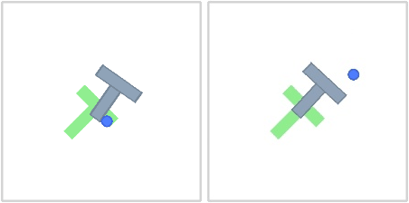
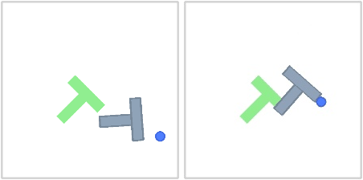
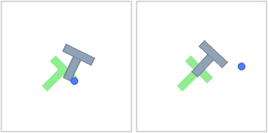
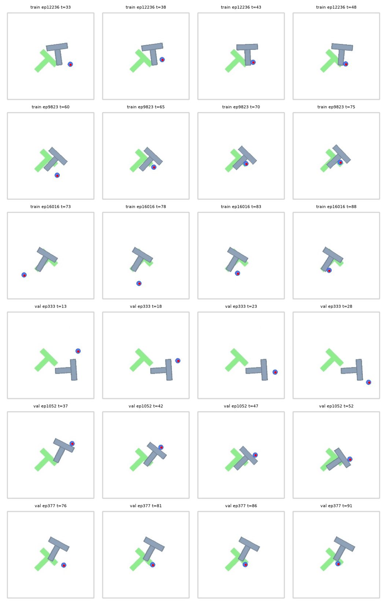
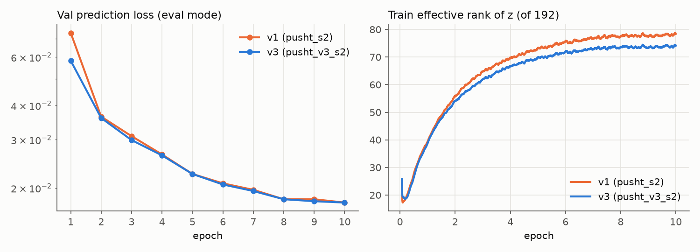
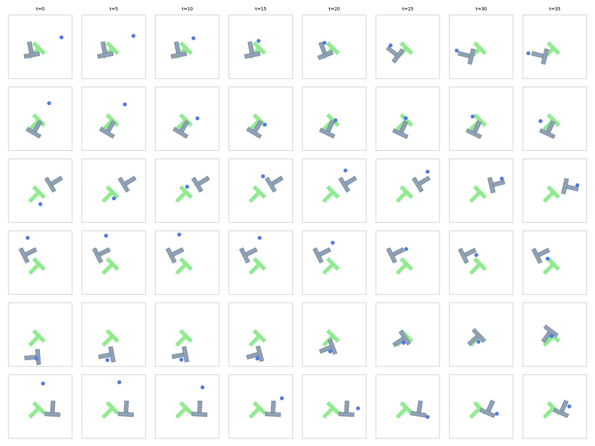
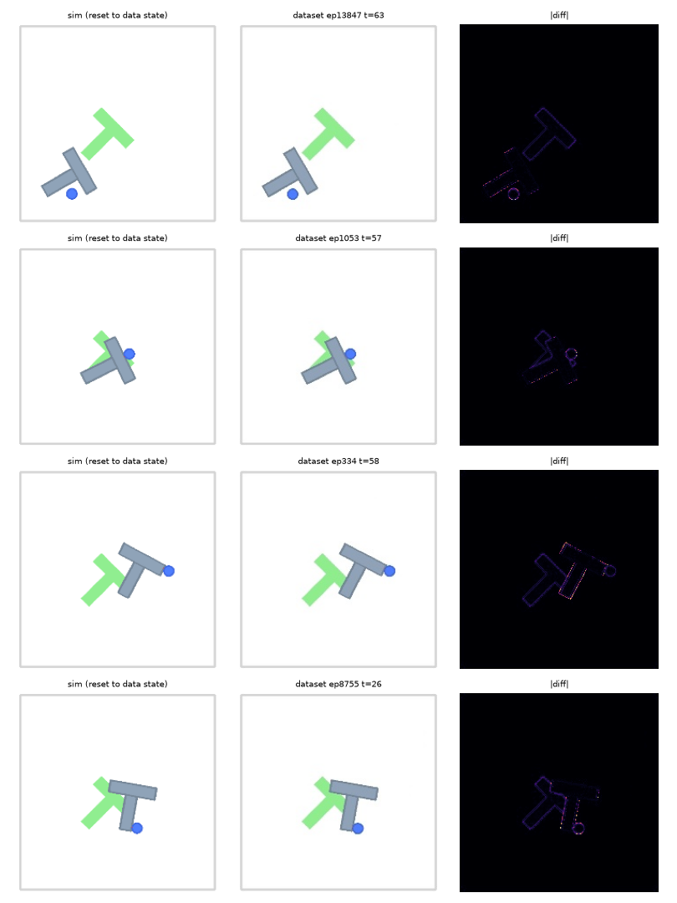

# LeWM from scratch on PushT

A from-scratch PyTorch reimplementation of **LeWorldModel (LeWM)**, a JEPA-style world model trained end to end from pixels with
two terms: a next-embedding prediction loss and **SIGReg**, a regularizer that pushes the embedding distribution toward an
isotropic Gaussian. There is no stop-gradient, no EMA target encoder and no reconstruction loss.

It is trained and evaluated on **PushT** on a single RTX 5070 Ti (16 GB). This is a learning project. No official code
was used or read, and no pretrained weights are used: the data loader, encoder, predictor, SIGReg, loss, training loop,
probes and CEM planner are all written from torch primitives.

- Paper: [`references/LeWorldModel.pdf`](references/LeWorldModel.pdf)
- Spec and phases: [`docs/PLAN.md`](docs/PLAN.md)
- Decisions, experiment table and full log: [`docs/PROGRESS.md`](docs/PROGRESS.md)

## Results

| Model | Architecture | Stride / steps | Planning: 50 val-group pairs | Planning: 50 random pairs | Linear probe r: agent / block / angle (random split) |
|---|---|---|---|---|---|
| Paper (LeWM) | — | — | 96.0 ± 2.8% | — | 0.974 / 0.986 / 0.902 |
| `pusht_s2` | v1 | 2 / 69,510 | 82% (95% CI 71–93%) | 76% (64–88%) | 0.986 / 0.989 / 0.914 |
| **`pusht_v3_s2`** | v3 | 2 / 69,510 | **84% (74–94%)** | **90% (82–98%)** | **0.992 / 0.994 / 0.937** |
| `pusht_v3_s1` | v3 | 1 / ≈ 138k | not run yet ([future work](#future-work)) | — | — |

- **Planning:** CEM (300 samples, top 30, 30 iterations, horizon 5 blocks) with MPC in `swm/PushT-v1`, goal 25 steps ahead,
  50-step budget, success from the env's own check. Plan time is 0.33 s per plan for v3 (0.35 s for `pusht_s2`; paper ≈ 1 s).
- **v3 vs v1 on the same pairs:** on the val-group pairs it's a tie (36 succeed with both, 5 only v1, 6 only v3). On the random
  pairs (drawn from any episode, `--split random`) v3 is better: 38 both, 0 only v1, 7 only v3 (exact McNemar p ≈ 0.016).
  One seed each.
- **Probes** (frozen encoder, val-group frames). MLP r for v3: 1.000 / 1.000 / 0.988 (v1: 0.999 / 0.999 / 0.986). On the
  stricter group split (unseen starting states) v3's linear r is 0.969 / 0.967 / 0.808, up from v1's 0.930 / 0.930 / 0.718.
- `pusht_s2` was trained with the v1 architecture and doesn't load with the current `model.py`; use the model file from
  commit `f3eeb04` to re-evaluate it.

### Planning examples (`pusht_v3_s2`, val-group pairs)

Each GIF shows the simulator on the left and the goal frame (the dataset frame 25 steps later) on the right.

<table>
<tr>
<td align="center"><br>Success, episode 313: reached in 18 steps</td>
<td align="center"><br>Success, episode 308: reached in 25 steps</td>
</tr>
<tr>
<td align="center"><br>Failure, episode 345: block 36 px and 0.55 rad off after 50 steps</td>
<td align="center"><br>Failure, episode 318: block in place (3 px), but the agent is 31 px away</td>
</tr>
</table>

The episode-318 failure is a common pattern: the env's success check counts the agent's position as well as the block's.

## Model (`src/lewm/model.py`, current = v3)

About 18M parameters in total (`uv run python -m lewm.model` prints the counts).

- **Encoder:** ViT-Tiny/14 on 224×224 frames. Conv2d patchify into 256 patches plus CLS, learned position embeddings,
  12 pre-norm blocks (3 heads, width 192, MLP 768, affine LayerNorm eps 1e-12), final LayerNorm.
  The CLS token goes through a projector to give the 192-d embedding `z`.
- **Projector** (encoder and predictor): Linear 192→2048 → BatchNorm1d → GELU → Linear 2048→192.
- **Action encoder:** one block of 5 actions × 2 dims = 10 numbers → Conv1d(10→10, kernel 1) → Linear 10→768 → SiLU →
  Linear 768→192.
- **Predictor:** a ViT-S-based transformer, per the paper. Here: 6 causal blocks, 16 heads × 64, width 192, MLP 2048,
  dropout 0.1, learned positions for a history of 3. Actions condition every block through **adaLN-Zero**
  (shift, scale and gate, zero-initialized so each block starts as the identity), plus an inner LayerNorm in attention and
  MLP and no q/k/v bias. Final LayerNorm, then its own projector. Output t predicts the embedding at t + 1.
- **Inputs:** uint8 frames are normalized on the GPU as (x/255 − 0.5)/0.5. Actions are standardized with
  train-set mean/std, which are saved in every checkpoint.

## Loss (`src/lewm/loss.py`)

A sample is 4 frames 5 env steps apart plus 4 action blocks. The predictor sees frames 0–2 and blocks 0–2; block 3 is unused.

<p align="center"><br>
<em>Training windows (rows: 3 train, 3 val). The red dot is the agent position from the state vector, drawn on the frame.</em></p>

```
L = MSE(pred, emb[:, 1:]) + λ · SIGReg(emb)        # no stop-gradient on the target
```

**SIGReg:** for each of the 4 time steps, project the batch of embeddings onto 1024 fresh random unit directions and compute
the Epps–Pulley statistic: the distance between the empirical characteristic function and exp(−t²/2), weighted by
exp(−t²/2), integrated with the trapezoid rule on 17 knots. It is computed in FP32 with autocast off, and averaged over
directions and time steps.

| Setting | Paper text | Used here |
|---|---|---|
| λ | 0.1 (Algorithm 3) | **0.09** (the authors' actual value) |
| Knot interval | [0.2, 4] (App. A) | **[0, 3]** (the authors' actual value), ×2 for the full real line |
| Batch scaling | none (App. A formula) | **×N**, the conventional N·T statistic; without it the embedding collapsed |

## Training (`src/lewm/train.py`)

| | |
|---|---|
| Epochs / batch | 10 / 128 (fixed) |
| Optimizer | AdamW, lr 5e-5, weight decay 1e-3, grad clip 1.0 |
| Schedule | linear warmup over 5% of steps, then cosine to 0 |
| Precision | BF16 autocast; SIGReg in FP32 |
| Data split | 90/10 by starting-state group: 185 groups × 101 episodes, 166 train / 19 val (seed 3072) |
| Window stride | 5 (early runs), 2 (`pusht_s2`, `pusht_v3_s2`), 1 (`pusht_v3_s1`) |
| Logging | wandb: losses, embedding std, effective rank, grad norm, it/s; val loss and checkpoint every epoch |

`pusht_s2` took ≈ 3 h 56 min at 4.94 it/s and `pusht_v3_s2` ≈ 3 h 57 min at ≈ 4.9 it/s, both with 11.2 GiB peak VRAM.

<p align="center"><br>
<em>v1 vs v3 at stride 2. Both end at the same val prediction loss (0.0177); v3 settles at a slightly lower effective rank
(≈ 74 vs 78) but plans and probes better.</em></p>

## What we learned

- **Dimensional collapse can hide behind healthy-looking metrics.** The first full run (no ×N in SIGReg) had falling losses
  and embedding std ≈ 0.8, but the embedding's effective rank was ≈ 3 of 192 and probes were far below the paper. Adding the
  ×N factor fixed it (1-epoch ablation: rank 1.0 → 25.5). We now log effective rank during training.
- **The projector needs BatchNorm.** SIGReg works on the distribution across the batch, and BatchNorm acts on that same axis.
  A LayerNorm projector stalled near zero scale for ≈ 1k steps and ended far behind (0/50 vs 9/50 dev plans after 1 epoch).
- **ImageNet normalization hurt.** v2 used ImageNet mean/std on these synthetic renders and fell behind v1 on every metric;
  removing only that change (v3) brought it back to v1's level.
- **v3 beats v1 over a full run.** With the same stride-2 recipe, v3 ties v1 on the val-group pairs (84% vs 82%), is clearly
  better on the random pairs (90% vs 76%), and its probes are better on unseen starting states, even though both reach the
  same val loss.
- **The world model, not CEM, limits planning.** CEM finds a lower *predicted* cost than the expert's own actions in 49/50
  pairs, but the frame it actually reaches is much further from the goal: it exploits prediction error. Longer training
  (stride 5 → 2) raised planning from 60% to 82%.
- **The env's success check includes the agent.** Several failures have the block in place but the agent too far away.
- **I/O matters.** Reading a contiguous HDF5 slice and subsampling was 27× faster than list indexing on the Blosc-chunked
  frames, which made training GPU-bound.

## Deviations from the paper

- **Dataset size:** the released file has 18,685 episodes averaging 125 steps; the paper describes 20,000 averaging 196.
- **Split by starting-state group**, so validation, probe test and evaluation pairs use unseen starting states.
- **Choices where the paper is silent:** the action encoder, the adaLN-Zero form, weight init, SIGReg weight width and
  direction sharing, CEM details. Each is logged in the PROGRESS.md decisions table.
- **SIGReg values** follow the authors' practice rather than the paper text (table above).

## Setup

Requires Python 3.12 and [uv](https://docs.astral.sh/uv/). torch 2.11.0+cu128 comes from the PyTorch cu128 index
(needed for Blackwell sm_120).

```bash
uv sync
uv run python scripts/check_gpu.py
```

**Data:** download `pusht_expert_train.h5.zst` (~13 GB) from the Hugging Face **dataset** repo `quentinll/lewm-pusht`
and decompress it to `data/pusht_expert_train.h5` (~43 GiB):

```bash
hf download quentinll/lewm-pusht pusht_expert_train.h5.zst --repo-type dataset --local-dir data/raw
zstd -d data/raw/pusht_expert_train.h5.zst -o data/pusht_expert_train.h5
```

**Simulator:** `swm/PushT-v1` from `stable-worldmodel`, used only as the environment. It is already in `pyproject.toml`.

<p align="center"><br>
<em>Dataset frames: six episodes, every 5 steps. Grey T = block, green T = fixed target, blue dot = agent.</em></p>

<p align="center"><br>
<em>The simulator reset to a dataset state renders the same frame (mean |diff| under 0.6 of 255, only along edges).</em></p>

## Usage

```bash
# Tests (data and GPU tests are skipped if those aren't available)
uv run pytest -q

# Inspect the dataset; write the group split and a window grid
uv run python -m lewm.data.inspect --path data/pusht_expert_train.h5 --out outputs/inspect/
uv run python -m lewm.data.pusht --path data/pusht_expert_train.h5 --out outputs/windows/

# Train
uv run python -m lewm.train --config configs/smoke.yaml        # tiny subset, a few minutes
uv run python -m lewm.train --config configs/pusht_v3_s2.yaml  # full run, stride 2
uv run python -m lewm.train --config configs/pusht_v3_s1.yaml  # full run, stride 1
# add --resume to continue from last.pt, --max_steps 50 for a timing check

# Probes (give each checkpoint its own --out: embeddings are cached there)
uv run python -m lewm.eval.probe --ckpt outputs/runs/pusht_v3_s2/last.pt --out outputs/eval/pusht_v3_s2

# Planning on the 50 fixed val-group pairs (or --split random)
uv run python -m lewm.plan --ckpt outputs/runs/pusht_v3_s2/last.pt --out outputs/eval/pusht_v3_s2
```

`configs/pusht.yaml` is the `pusht_s2` config (v1 architecture). `configs/smoke.yaml` still uses λ = 0.1 without ×N; it is
only a smoke test. Planning writes `plan_results.json` and a few success/failure GIFs; probes write `probes.json`.

## Repository layout

```
configs/            training configs; splits/ (group split), eval/ (fixed evaluation pairs)
docs/               PLAN.md (spec), PROGRESS.md (decisions, experiments, log)
references/         the paper
scripts/            check_gpu.py
src/lewm/
  data/             pusht.py (split, windows, Dataset), inspect.py (HDF5 inspector)
  model.py          encoder, projectors, action encoder, predictor
  loss.py           SIGReg, LeWM loss, effective rank
  train.py          training loop
  eval/probe.py     linear and MLP probes
  plan.py           CEM planner and MPC evaluation
tests/              data, model, loss, planner and CUDA tests
data/, outputs/     dataset, checkpoints, eval results (gitignored)
```

## Future work

- **Full stride-1 training** (`configs/pusht_v3_s1.yaml`, ≈ 138k steps, ≈ 8 h) to compare with the paper's 96%.
- **Implement the new slow SVReg** (released 18 November 2026) to further improve the planner's performance on the PushT dataset.
- The surprise test (prediction error on teleported and recolored rollouts).
